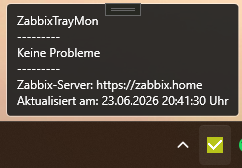
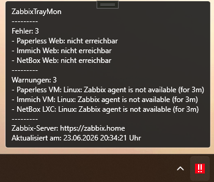
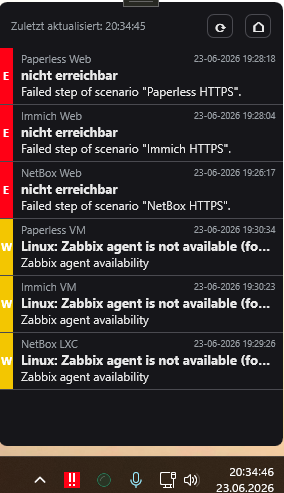
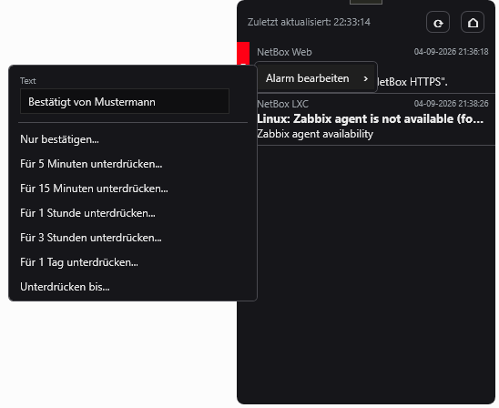
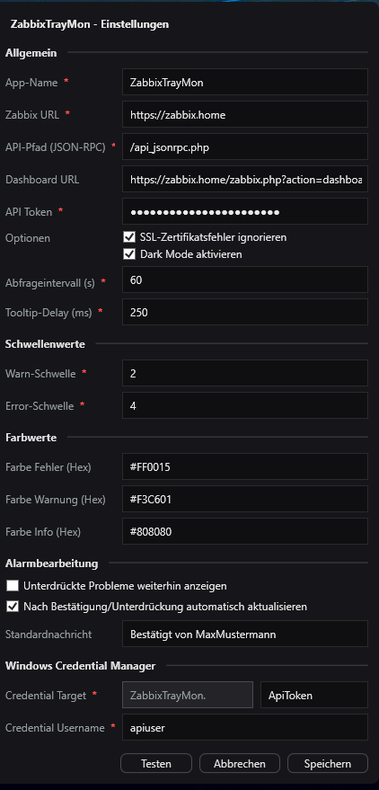

# Zabbix Monitor

[](https://github.com/petrsykora/ZabbixTrayMonitor/releases/latest)
[](https://github.com/petrsykora/ZabbixTrayMonitor/releases)
[](https://github.com/petrsykora/ZabbixTrayMonitor/actions/workflows/release.yml)
[](LICENSE)
[](https://github.com/petrsykora/ZabbixTrayMonitor/commits/master)


Small Windows tray client for Zabbix.

The application runs in the Windows system tray and shows the current Zabbix status through a colored tray icon, a tooltip and a small problems window.

The tray icon shows at a glance whether everything is fine, there are warnings or there are errors. The tooltip and the problems window list the current relevant Zabbix problems.

## Features

- Tray status for OK, warning, error and unknown state
- Automatic refresh with a configurable poll interval
- Compact tooltip with the most important current problems
- Configurable delay before the tray tooltip opens
- Problems window with host, time, message and monitored object
- Dark and light mode
- User interface in English, German and Czech; follows the Windows display language by default (English if the system language is not supported) or can be fixed in the settings
- API token stored in the Windows Credential Manager
- Built-in help (tray menu > Help, or F1) and an About window with version, origin and license
- Alarm handling directly in the problems window:
  - Acknowledge only
  - Suppress for 5 minutes
  - Suppress for 15 minutes
  - Suppress for 1 hour
  - Suppress for 3 hours
  - Suppress for 1 day
  - Suppress until a freely chosen date/time
- Configurable default message for acknowledgements/suppressions
- The message can be overridden per action directly in the context menu
- Suppressed problems can optionally still be shown
- Optional automatic refresh after an alarm action, including a delayed follow-up refresh

## Download

`setup.exe`, MSI installers and portable ZIPs are attached to every [release](https://github.com/petrsykora/ZabbixTrayMonitor/releases/latest). Changes per version are listed in the [changelog](CHANGELOG.md).

## Documentation

- [Deployment](docs/deployment.md): silent installation, Group Policy, Intune, update, uninstall, preparing settings for users
- [Zabbix setup](docs/zabbix-setup.md): Zabbix user, role, permissions and API token with as few permissions as possible
- [Troubleshooting](docs/troubleshooting.md): connection, certificate, permission and installation problems
- [Code signing](docs/code-signing.md): signing the releases with your own certificate and trusting it via Group Policy
- [Development](docs/development.md): building, installers, translations and releasing a new version

The application also contains a built-in help (tray menu → **Help**, or F1).

## Installation

### Which file do I need?

Every release contains these files:

| File | Size | .NET runtime | Use it for |
|---|---|---|---|
| `…-win-x64-setup.exe` | small | installed automatically if missing | **Recommended** for installing on a single computer |
| `…-win-x64-runtime-dependent.msi` | small | must already be installed | Scripts, Intune or Group Policy where the .NET 10 Desktop Runtime is deployed separately |
| `…-win-x64-runtime-dependent.zip` | small | must already be installed | Portable use without installation |
| `…-win-x64.msi` | large | included | Scripts, Intune or Group Policy without a separate runtime, offline computers |
| `…-win-x64.zip` | large | included | Portable use without installation and without the runtime |

The application needs the **.NET 10 Desktop Runtime (x64)**. `setup.exe` checks whether it is installed; if not, it downloads it from Microsoft and installs it before the application. The runtime stays installed when the application is uninstalled. The runtime-dependent MSI refuses to install without the runtime and tells you where to get it. If the runtime is missing when the runtime-dependent ZIP is started, Windows offers to download it.

All installers:

- install the application for all users to `C:\Program Files\ZabbixTrayMonitor` (administrator rights required)
- add a Start menu shortcut and start the application automatically when a user signs in
- offer to start the application right away at the end of an interactive installation (checkbox in the MSI, **Launch** button in `setup.exe`); silent installations do not start it
- replace older versions (and the other MSI variant) automatically on update and close a running instance first
- keep the user's settings (`config.json`) and the API token in the Credential Manager on uninstall

Silent installation, for example for scripts or Intune:

```powershell
msiexec /i ZabbixTrayMonitor-v1.3.3-win-x64.msi /qn
```

Add `AUTOSTART=0` to install without autostart. `setup.exe` runs silently with `/quiet`. Group Policy, Intune, updates and uninstalling are described in [Deployment](docs/deployment.md).

### winget (local manifest)

The package is not in the official Windows Package Manager catalog yet. The manifests in `winget/manifests` can be used to install it with winget from a local copy of the repository. Local manifests have to be allowed once by an administrator:

```powershell
winget settings --enable LocalManifestFiles
```

```powershell
winget install --manifest winget\manifests\p\PetrSykora\ZabbixMonitor\1.3.1
```

Submitting the package to the official catalog is prepared but not done yet: the **winget** workflow submits a manifest folder to `microsoft/winget-pkgs`, and the release workflow submits every new version automatically. Both only run when the `WINGET_TOKEN` secret (classic token with the `public_repo` scope) is set.

### ZIP (portable)

1. Download and extract one of the ZIPs: `…-win-x64-runtime-dependent.zip` (small, needs the .NET 10 Desktop Runtime) or `…-win-x64.zip` (runtime included).
2. Start `ZabbixTrayMonitor.exe`. Nothing is installed and there is no autostart.

### First start

1. On first start the **Settings** window opens.
2. Enter the **Zabbix URL** and the **API token**.
3. Check the connection with **Test**, then click **Save**.

## Screenshots

### Tray tooltip without problems



### Tray tooltip with problems



### Problems window



### Alarm handling



### Settings



## Config

The configuration is stored in:

```text
%AppData%\ZabbixTrayMonitor\config.json
```

Example:

```json
{
  "ZabbixUrl": "https://zabbix.home",
  "ZabbixDashboardUrl": "https://zabbix.home/zabbix.php?action=dashboard.view&dashboardid=407",
  "PollIntervalSeconds": 60,
  "TrayToolTipDelayMilliseconds": 250,
  "IgnoreCertificateErrors": false,
  "UseDarkMode": true,
  "Language": "",
  "ShowSuppressedProblems": false,
  "RefreshAfterProblemAction": true,
  "AcknowledgeMessage": "Acknowledged by john.doe",
  "WarningSeverityThreshold": 2,
  "ErrorSeverityThreshold": 4,
  "CredentialTargetSuffix": "ApiToken",
  "CredentialUsername": "api-token"
}
```

## Languages

The user interface is available in English, German and Czech. By default it follows the Windows display language; if that language is not supported, English is used. Under **Settings → Language** you can choose a fixed language instead (`Language` in config.json: `""` for the system language, `"en"`, `"de"` or `"cs"`). The change takes effect right after saving.

How to change texts or add another language is described in [Development](docs/development.md#translations).

## Severity mapping

The Zabbix API returns severity values between 0 and 5:

```text
0 = Not classified
1 = Information
2 = Warning
3 = Average
4 = High
5 = Disaster
```

`WarningSeverityThreshold` defines from which severity a problem counts as a warning.

`ErrorSeverityThreshold` defines from which severity a problem counts as an error.

Defaults:

```text
Severity 0-1 -> ignored
Severity 2-3 -> warning
Severity 4-5 -> error
```

## Alarm handling

Right-clicking a problem opens the `Edit alarm` menu.

`Acknowledge only...` runs `event.acknowledge` in Zabbix with an acknowledgement and a message.

The time-limited suppressions acknowledge the event, add the message and suppress the problem until the selected time.

If `ShowSuppressedProblems` is `false`, suppressed problems are hidden from the tray status, the tooltip and the problems window.

## API

The application uses the Zabbix JSON-RPC API.

The API path is fixed to `/api_jsonrpc.php` as defined by Zabbix. If Zabbix runs in a subdirectory, include it in the Zabbix URL (for example `https://zabbix.example.com/zabbix`). Older configurations with a custom API path are migrated automatically.

Authentication uses a bearer token.

For the problem list, the current problems are queried in bulk and enriched with host names and trigger/item information. No separate API request is made per problem.

Zabbix API methods used:

```text
problem.get
event.get
trigger.get
event.acknowledge
apiinfo.version
```

The user behind the API token needs the required Zabbix permissions. For alarm handling, acknowledging and suppressing the affected events must be allowed. A step-by-step setup with as few permissions as possible is described in [Zabbix setup](docs/zabbix-setup.md).

### Security notes

- The API token is sent with every request. Connect to the Zabbix server via **https://**; for http:// the application asks for confirmation when saving.
- `IgnoreCertificateErrors` disables certificate validation completely. An attacker on the network could then impersonate the Zabbix server and steal the token. For self-signed certificates, import the certificate or your own CA as trusted in Windows instead.
- Use a dedicated Zabbix user with as few permissions as possible for the token (read access to the relevant host groups, and acknowledge/suppress if needed).

To report a security vulnerability, see [SECURITY.md](SECURITY.md).

## Code signing

The release files are not signed yet. How to sign them with your own code signing certificate, distribute the certificate via Group Policy and avoid SmartScreen warnings is described in [Code signing](docs/code-signing.md).

## License and origin

Zabbix Monitor is based on [ZabbixTrayMonitor](https://github.com/Darano94/ZabbixTrayMonitor) by Darano94 and is distributed under the MIT License, see [LICENSE](LICENSE). The original copyright notice and the license text are kept in the repository, shipped with every build as `LICENSE.txt` (ZIP and MSI) and shown in the application under **About → License**.

## Libraries

### Hardcodet.NotifyIcon.Wpf

WPF support for Windows system tray icons.

### CredentialManagement

Access to the Windows Credential Manager.
